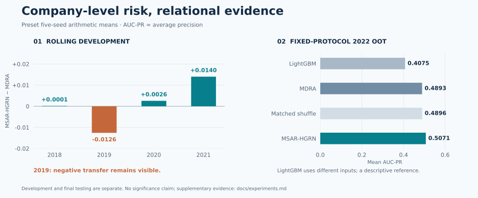

# Experimental evidence · 实验证据

[Home](../README.md) · [Temporal protocol](strict_temporal_protocol.md) · [Aggregate JSON](evidence.json)

All figures below were checked against accepted summary/metric files, not copied from an earlier conversational summary. No inference, training or metric recomputation from private predictions was performed for this refresh. The public JSON stores only reviewed aggregates and source identifiers.

## Reading the numbers

- **Primary metric:** AUC-PR, implemented as average precision.
- **Primary aggregation:** arithmetic mean over seeds 42, 52, 62, 72 and 82. Deterministic logistic regression is a single result.
- **Same final population:** 5,132 companies, 123 positive cases in 2022.
- **Budget recall:** fraction of positives captured in the top 5% / 10% of the ranked population.
- **F1:** fixed probability threshold 0.5, not a test-selected optimal threshold.
- Five-seed metric means and metrics of five-seed averaged probabilities are different quantities.

## 1 · Does company history help build the anchor?

The first comparison tests MDRA's company-specific historical reference, before adding graph residuals. All rows retain financial-change features and historical-risk statistics in their base inputs. The current-state-reference control replaces the historical reference **inside the deviation branch**, while retaining history availability. It is not a model with all historical information removed.

| Development setting | 2018 | 2019 | 2020 | 2021 | Four-year mean |
| :--- | ---: | ---: | ---: | ---: | ---: |
| No-deviation control | 0.5385 | 0.5768 | 0.4961 | 0.4665 | 0.5195 |
| Current-state-reference control | 0.5617 | 0.5719 | 0.4859 | 0.4591 | 0.5197 |
| Shuffled-history control | 0.5171 | 0.5630 | 0.4858 | 0.4938 | 0.5149 |
| MDRA · real company history | **0.5978** | **0.6360** | **0.5067** | **0.5795** | **0.5800** |

MDRA is higher in every development year. Its four-year mean gain is **+0.0603** over the current-state-reference control and **+0.0651** over shuffled history. These three arms share the encoding structure and parameter count. History shuffling preserves history length and text-missingness patterns, but changes the company–history correspondence. The comparison supports the predictive value of the same company's historical reference, rather than historical inputs in general.

## 2 · Does a more elaborate relation module help?

The variants keep the frozen MDRA anchor and peer-selection rule. Neighbor attention replaces relation-wise mean aggregation with learned target-conditioned weights. The explicit-difference variant adds a parallel encoding of hidden-state and probability differences to messages that already contain such differences.

| Development model | 2018 | 2019 | 2020 | 2021 | Four-year mean | Mean Δ vs MSAR-HGRN |
| :--- | ---: | ---: | ---: | ---: | ---: | ---: |
| MSAR-HGRN | **0.5979** | 0.6234 | 0.5093 | **0.5935** | **0.5810** | — |
| Anchor-conditioned neighbor attention | 0.5974 | **0.6289** | 0.5092 | 0.5829 | 0.5796 | −0.001453 |
| Explicit difference representation | 0.5951 | 0.6238 | **0.5117** | 0.5860 | 0.5791 | −0.001908 |

Neither variant improves the four-year mean over the retained module, despite gains in some years. This supports retaining mean aggregation, reliability gating and cross-relation fusion in the tested framework; it does not identify the isolated causal contribution of each component. These are development results, not additional 2022 tests.

## 3 · Rolling development: an uneven relational increment

| Year | MDRA AUC-PR | MSAR-HGRN AUC-PR | Difference |
| ---: | ---: | ---: | ---: |
| 2018 | 0.597773 | 0.597915 | +0.000142 |
| 2019 | 0.636014 | 0.623425 | -0.012589 |
| 2020 | 0.506731 | 0.509296 | +0.002565 |
| 2021 | 0.579532 | 0.593541 | +0.014009 |

The four-year mean increment is **+0.001032**. The 2019 decline is part of the conclusion, not an outlier removed from reporting. Annual variation is considerably larger than the mean gain.

The auxiliary **LightGBM-Source65** reference uses the same annual 65-dimensional source features as MDRA, without its dual current–history encoder. Its annual AUC-PR is 0.5247 / 0.5719 / 0.4484 / 0.4747, with a four-year mean of **0.5049**. This is distinct from the 901-dimensional tabular LightGBM in the final table. No Source65 result exists for 2022.

## 4 · Final fixed-protocol anchor / relation comparison

| Arm | Five-seed mean AUC-PR |
| :--- | ---: |
| MDRA (T0_D3) | 0.489256 |
| MSAR-HGRN, real relations (T1_F0_REAL) | 0.507052 |
| Matched shuffled relations (T2_F0_SHUFFLE) | 0.489639 |

- Real minus anchor: **+0.017797**, positive in 5/5 paired seeds.
- Real minus matched shuffle: **+0.017414**, positive in 5/5 paired seeds.

Real and shuffled arms share the residual structure, candidate training-step grid and validation-selection rule, **not necessarily the selected step count**. The 2021 validation selected 300 steps for real relations and 20 for shuffled relations. The final result supports predictive relational supplementation under this protocol, not a same-step isolation of topology alone.

## 5 · Locally evaluated baselines and the proposed models

| Model | AUC-PR ↑ | AUC-ROC ↑ | LogLoss ↓ | F1 @ 0.5 ↑ | R@5% ↑ | R@10% ↑ |
| :--- | ---: | ---: | ---: | ---: | ---: | ---: |
| Logistic regression¹ | 0.025249 | 0.500220 | 0.704830 | 0.039627 | 0.048780 | 0.105691 |
| LightGBM | 0.407467 | 0.925975 | 0.072930 | 0.316580 | 0.622764 | 0.764228 |
| XGBoost | 0.336483 | 0.921669 | 0.079920 | 0.330464 | 0.575610 | 0.747967 |
| RGCN | 0.024694 | 0.504132 | 2.191274 | 0.021701 | 0.055285 | 0.107317 |
| HGT | 0.024858 | 0.509413 | 1.860234 | 0.036326 | 0.073171 | 0.115447 |
| MDRA | 0.489256 | 0.945054 | 0.056671 | 0.585282 | 0.809756 | 0.866667 |
| MSAR-HGRN | 0.507052 | 0.947675 | 0.054272 | 0.576771 | 0.814634 | 0.871545 |

¹ Deterministic single run. All other rows are five-seed arithmetic means.

The adapted FFD-DHG-inspired run remains in [supplementary evidence](#supplementary-evidence), separate from the original paper's FFD-DHG report below.

MSAR-HGRN's AUC-PR is **+0.099586** above the tabular LightGBM reference. Its mean Recall@5% / Recall@10% is **81.46% / 87.15%**, versus LightGBM's 62.28% / 76.42%: increases of **19.19 / 10.73 percentage points**. The practical interpretation is stronger ranking for budget-limited screening. F1 at 0.5 remains lower than MDRA; not all metrics improve.

### Comparison boundary

These models share the audited final evaluation population, but **their input families and modeling pipelines differ**. LightGBM's 0.407467 and MSAR-HGRN's 0.507052 can be compared descriptively; the difference does not isolate architecture under matched source inputs. Poor RGCN/HGT results here do not establish that these architectures are generally ineffective.

The supplementary **LightGBM-Source65** same-input comparison has status `BLOCKED_INPUT_UNAVAILABLE` for 2022. No test prediction or metric exists for that row. Do not substitute the ordinary LightGBM result or another text encoder; see [the availability explanation](experiment_status.md#source65-is-an-availability-blocker).

## 6 · FiGraph literature reports: a separate evidence group

These rows were checked against the original sources. They are **reported paper means, not our local 2022 reproductions**. Input families, year aggregation and evaluation protocols differ.

| Method | Reported AUC-PR / AP | Reported AUC-ROC | Source and setting |
| :--- | ---: | ---: | :--- |
| FFD-DHG | 0.1493 | 0.7629 | [Original paper, Table 2](https://www.sciencedirect.com/org/science/article/pii/S2771589226000044); multi-year aggregate |
| TGTOD | 0.1600 | 0.7860 | [Author preprint v1, Table 3](https://arxiv.org/pdf/2412.00984v1); stationary setting |
| GLT-GAD | 0.2630 | 0.7940 | [Original paper, Table 2](https://link.springer.com/content/pdf/10.1007/s44196-026-01456-z.pdf); paper-specific FiGraph protocol |
| FSFDLLM | 0.4889 | 0.8628 | [Original paper, Table 2](https://spj.science.org/doi/10.34133/icomputing.0274); multi-year aggregate |

MSAR-HGRN's 0.5071 is numerically **0.0182** above FSFDLLM's reported 0.4889. This is a descriptive cross-paper difference, not a matched-protocol superiority or significance claim. MDRA's 0.4893 is close to that report; the approximately 0.0004 gap is not presented as a substantial advantage.

FFD-DHG and FSFDLLM report multi-year summaries, not isolated 2022 scores. TGTOD also reports a non-stationary setting (AP 0.1510, AUC-ROC 0.8060); the table consistently uses its stationary row rather than mixing best metrics across settings. GLT-GAD uses its own split, preprocessing and ten-run summary. Reported Macro-F1, Macro-Recall and differently defined Recall@k must not be inserted into our fraud-class F1 or Recall@5% / Recall@10% columns.

## 7 · What the evidence supports

In this dataset and protocol, current–history deviations help construct an intrinsic anchor, and real heterogeneous relations provide directionally positive incremental evidence in the final test. The graph contribution remains year-dependent and uncertain.

The results do **not** establish causal fraud transmission, uniformly positive transfer, statistical significance, broad state-of-the-art superiority, or production deployment validity. No test-driven repair or successor model is introduced by this showcase.

## Provenance

The evidence snapshot was checked on **2026-10-11** against accepted result files. Existing final and baseline aggregates are unchanged from the previous snapshot; added development summaries were checked directly against accepted files. Source revision identifiers and original run identities are retained in [the aggregate JSON](evidence.json).

| Evidence | Accepted source |
| :--- | :--- |
| Development rows | `s24_2_anchor_selective_native_gnn/formal/20260905T014639704710Z/seed_metrics.csv` |
| Final arms and bootstrap | `final_2022_oot/20260918T132623475938Z/`: seed metrics, ensemble metrics, OOT summary, bootstrap |
| External baseline means | `baseline_benchmark/final_2022/`: each model's summary |
| History-reference controls | `s16_risk_deviation_hetero_gnn/s16_1_current_history_deviation/20260901T094703Z/seed_metrics.csv` |
| Neighbor-attention variant | `s37_0r4_no_rerun_audit_contract_recovery/formal/20260918T012139125681Z-4ddc1d9d7ac04d879bf0eda6d5f35a15/year_metrics.csv` |
| Explicit-difference variant | `f2_0_difference_aware_residual/formal/20260918T064542357942Z/year_metrics.csv` |
| Source65 development reference | `baseline_benchmark/development/lightgbm_source65/20260923T100024Z-665985d0/year_summary.csv`, `five_seed_mean` rows |

These are source identifiers for traceability, not promises that the private artifact paths are downloadable from this public repository.

## Supplementary evidence

The archived results below complement the primary seed-mean comparisons. They remain unchanged; presenting them separately does not establish significance or remove uncertainty.

Archived Bootstrap uncertainty and seed-mean / ensemble distinctions

The paired bootstrap first averages the five seed probabilities for each company and arm, then resamples companies within positive/negative strata. It uses 10,000 replicates. These intervals are **not across-seed confidence intervals around mean metrics**.

| Paired comparison | Bootstrap mean difference | Percentile 95% interval |
| :--- | ---: | :--- |
| Real − MDRA | +0.017781 | [−0.017470, +0.056282] |
| Real − matched shuffle | +0.017348 | [−0.017450, +0.055039] |

Both intervals cross zero. Neither 5/5 positive seeds nor the bootstrap mean establishes statistical significance.

| Reporting mode | MDRA | Real graph residual | Reading |
| :--- | ---: | ---: | :--- |
| Five-seed mean F1 @ 0.5 | 0.585282 | 0.576771 | Decreases |
| Five-seed mean Recall @ 5% | 0.809756 | 0.814634 | Increases |
| Five-seed mean Recall @ 10% | 0.866667 | 0.871545 | Increases |
| Ensemble AUC-PR | 0.492451 | 0.507894 | Increases |
| Ensemble Recall @ 5% | 0.821138 | 0.813008 | Decreases |
| Ensemble Recall @ 10% | 0.878049 | 0.878049 | Unchanged |

The homepage consistently uses seed means. The ensemble Recall@5% decrease must not be described as a decrease in the primary five-seed mean Recall@5%.

Adapted FFD-DHG-inspired implementation — not an official reproduction

| Local auxiliary model | AUC-PR | AUC-ROC | LogLoss | F1 @ 0.5 | R@5% | R@10% |
| :--- | ---: | ---: | ---: | ---: | ---: | ---: |
| FFD-DHG-inspired | 0.148570 | 0.859742 | 0.187617 | 0.268376 | 0.409756 | 0.611382 |

This is the sixth completed runnable baseline, retained for traceability. It is a strict-temporal adaptation, not the original-paper FFD-DHG row and not an official exact reproduction. Its input and evaluation choices must not be conflated with the literature values.

