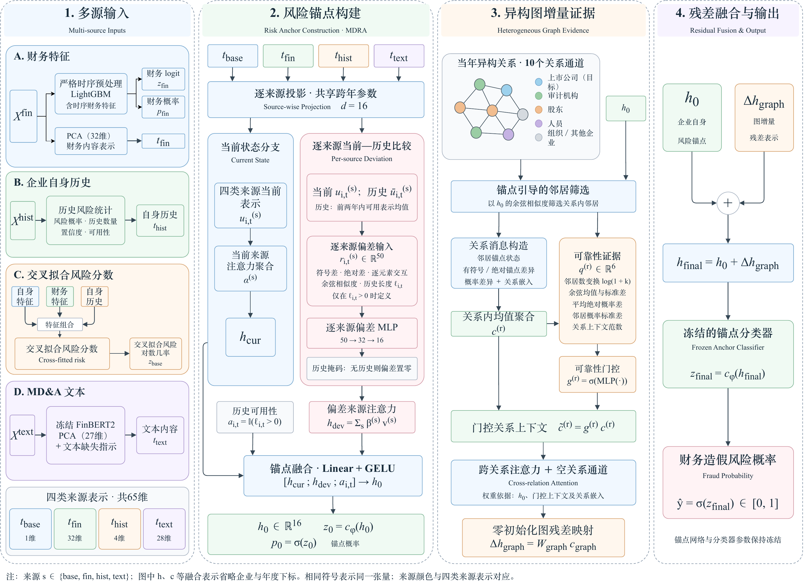

# Methodology · 模型方法

[Home](../README.md) · [中文首页](../README_CN.md) · [Implementation boundary](implementation.md)

## Research question

Can heterogeneous relations add predictive information on top of a strong company-level risk representation? The thesis separates intrinsic risk modeling from relational correction. These are predictive associations within the studied data, not evidence of fraud causation.

| Thesis name | Experimental ID | Role |
| :--- | :--- | :--- |
| MDRA — Multi-Source Deviation Risk Anchor | D3 | Multi-source current–history intrinsic anchor |
| MSAR-HGRN — Multi-Source Anchor-Guided Risk-Aware Heterogeneous Graph Residual Network | D3 + F0 | Frozen MDRA plus a learned heterogeneous graph residual |

## 1 · Multi-source company representation

The formal model uses four source groups, totaling 65 dimensions before source-wise projection.

| Source | Dimension | Construction |
| :--- | ---: | :--- |
| Cross-fitted risk | 1 | Risk logit from combined company-level / financial / self-history features |
| Financial content | 32 | Fold-fitted PCA representation of financial features |
| Self-history | 4 | Historical risk probability, count, confidence and availability |
| MD&A text | 28 | Frozen FinBERT2 representation, fold-fitted PCA to 27 dimensions, plus a missing-text indicator |

Each source has its own projection into a 16-dimensional hidden space. The same source projection is shared across years. Fitted transforms obey fold-specific temporal boundaries. Historical-label availability is an annual-data assumption, not verified exact disclosure-date availability; see the [protocol](strict_temporal_protocol.md).

## 2 · MDRA: current state and per-source deviation

For each source, the model compares the current representation with the masked mean of the same company's available representations from the previous two years. The deviation input contains:

- signed difference and absolute difference;
- element-wise interaction;
- cosine similarity;
- history length.

At hidden dimension 16, this is a 50-dimensional input to a source-specific MLP (50 → 32 → 16). If no valid history exists, the deviation is masked to zero. Separate attention mechanisms aggregate current-source states and deviation-source states.

The final anchor combines the current state, deviation state and history-availability indicator: 33 → 16 with GELU. The anchor classifier provides an intrinsic logit and risk probability.

The thesis tests this organization against no-deviation, current-state-reference and shuffled-history controls. The **current-state-reference control** replaces the historical reference inside the deviation branch with the current source state; it retains historical information already present in the base inputs and the history-availability indicator. It is not a history-free model. The current-state-reference, shuffled-history and real-history arms share the encoding structure and parameter count; see [the development evidence](experiments.md#1--does-company-history-help-build-the-anchor).

## 3 · Anchor-guided peer selection

The formal graph branch uses ten native relation channels derived from FiGraph's heterogeneous relations, including shared-background-entity channels and direct company links. Candidate peers exclude the target company.

FiGraph's target nodes are listed companies; background categories are **non-listed companies, natural persons, auditors and other entities**. Legacy channel labels such as “股东” (`holder`, U-prefix) and “组织实体” (`organization`, O-prefix) correspond to the non-listed-company and other-entity categories. These channel names, also retained in the approved thesis diagram, are not additional official node categories. This terminology clarification does not change graph identities or construction rules.

For each target and relation, rank candidates by cosine similarity to the frozen target anchor, then retain the top $\lceil n/2 \rceil$. Ties are resolved by ascending canonical peer index. Selection is deterministic, label-free and non-differentiable.

## 4 · Relation messages and reliability

A selected peer's message encodes its anchor state, its signed and absolute difference from the target anchor, the peer–target probability gap, and a relation embedding. With hidden dimension 16 and relation embedding dimension 4, the message MLP is 53 → 32 → 16. Messages are averaged within each relation.

A low-capacity gate uses six statistics, together with the relation embedding:

| Reliability input | Interpretation |
| :--- | :--- |
| log(1 + selected-peer count) | Amount of retained evidence |
| Cosine mean and standard deviation | Similarity level and dispersion |
| Mean absolute probability gap | Risk contrast |
| Peer-probability standard deviation | Risk dispersion |
| Relation-context norm | Context magnitude |

The gate is initialized with a conservative low prior. Cross-relation attention then uses the target anchor, gated context and relation embedding. An explicit zero-context NULL channel permits less reliance on observed relations.

## 5 · Frozen-anchor residual prediction

$$
h_{\mathrm{final}} = h_0 + \Delta h_{\mathrm{graph}},
\qquad
\Delta h_{\mathrm{graph}} = W_{\mathrm{graph}}c_{\mathrm{graph}}.
$$

$$
\hat y = \sigma\!\left(c_{\phi}(h_{\mathrm{final}})\right).
$$

The residual projection starts at zero. The MDRA encoder and classifier remain frozen while graph-branch parameters are optimized.

| Property | What it does **not** imply |
| :--- | :--- |
| Zero residual at initialization | Zero residual after training |
| Frozen anchor encoder and classifier | Unchanged predictions or guaranteed improvement |
| NULL attention channel | Guaranteed abstention whenever relations are harmful |
| Positive aggregate 2022 increment | Statistical significance or positive transfer every year |

If all relation channels are unavailable and the graph context is zero, the bias-free residual projection produces zero correction. With available channels, learned NULL attention does not generally force an exactly zero residual.

## 6 · Evidence-bound interpretation

The 2018–2021 comparison supports company-specific historical references and includes a negative graph increment in 2019. Final 2022 mean AUC-PR and budget recall improve relative to MDRA, while F1 at 0.5 decreases. The results support an anchor-plus-increment framing, not a claim that the architecture eliminates harmful propagation. [Supplementary uncertainty evidence](experiments.md#supplementary-evidence) remains archived; no statistical-significance claim is made.

The diagram and dimensions here describe the **formal thesis model**. The public code intentionally simplifies the feature pipeline, source encoder and training setup; see [the implementation guide](implementation.md).
